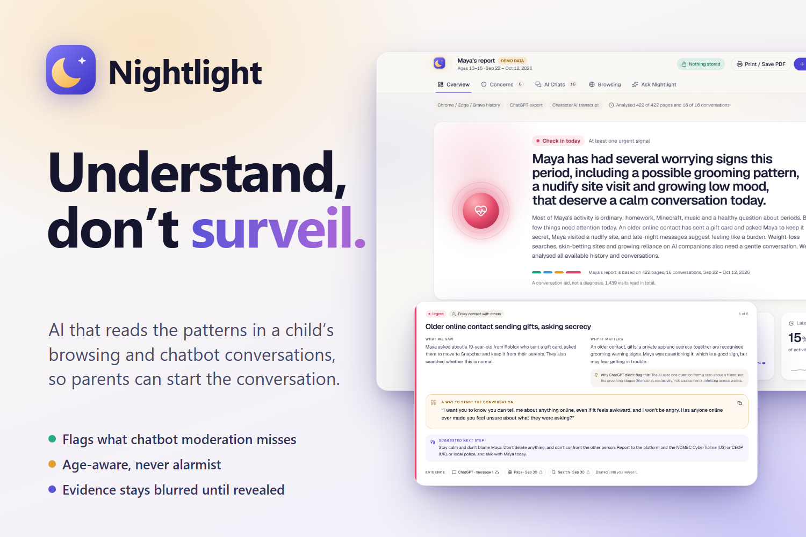

# 🌙 Nightlight



**Understand your child's online world, without reading every message.**

Nightlight is a privacy-first AI tool for parents. You give it your child's browser history and their AI-chatbot conversations (ChatGPT, Claude, Character.AI, …). It reads them through a **child-development lens** and gives you a calm, visual report: what's going well, what's worth a conversation, and how to start that conversation.

> ChatGPT sees one chat. Nightlight sees the pattern.

---

## The problem

Kids now talk to AI the way they used to talk to diaries and best friends. General-purpose chatbots are moderated for *adults*. They refuse obviously harmful requests, but they don't know they're talking to a 14-year-old, and they never see the bigger picture:

| What the chatbot saw | What a child-development expert would see |
|---|---|
| "How do I lose 5kg before the school dance?" → a sensible diet plan | A 14-year-old's body-image worry, given an adult diet plan |
| "How do I hide an app on my iPhone?" → step-by-step instructions | Secrecy from trusted adults |
| "My 19-year-old friend from Roblox sent me a gift card and said keep it between us" → good advice, once | A textbook grooming pattern (gifts, exclusivity, moving platforms) |
| Six separate 2am chats: "can't sleep", "everyone's fake", "you're the only one I can talk to" | Wellbeing drifting downward, and a growing emotional reliance on AI |
| A companion bot saying "I'll always be here, you don't need them" | An AI fostering dependency and isolation in a minor |

Existing parental-control tools mostly block sites or dump raw logs on parents. That's surveillance that damages trust, and the brief for this challenge explicitly warns against it.

## Who it's for

- **Parents and carers** of 6–17-year-olds who want to understand, not spy.
- **School counsellors and safeguarding leads** helping families after a concern is raised.
- **Researchers and AI-product teams** who want to audit how chatbots respond to children (see "AI-response audit" below).

## What it does

1. **Upload:** the browser history file (Chrome, Edge, Brave, Firefox, Safari, Google Takeout or CSV), a ChatGPT or Claude data export, or a pasted Character.AI, Snapchat My AI or Replika transcript.
2. **Analyse in the browser:** files are parsed **locally** with SQLite compiled to WebAssembly. URLs are deduped, search terms extracted, and personal details (addresses, schools, phone numbers, emails, handles) are **redacted before anything leaves the device**.
3. **AI analysis (Claude Haiku 5.5 + Sonnet 5.5):** the compact, redacted items are scored against the **Child Safety Lens**, a 14-dimension rubric, calibrated to the child's age band.
4. **Report:**
   - **Overview:** status, headline, KPIs, top concerns, what's going well, and a rubric scorecard.
   - **Concerns:** each concern has what we saw, why it matters, *why ChatGPT didn't flag it*, a warm **conversation starter**, a next step, and evidence that stays **blurred until you choose to reveal it**.
   - **AI Chats:** mood over time across conversations, the child's reliance on AI, and an **audit of every AI reply** (did it point the child to a trusted adult, or foster secrecy or dependency?).
   - **Browsing:** activity timeline, hour × weekday heatmap (late-night use), "digital diet", and the AI apps used.
   - **Ask Nightlight:** a chat assistant that answers a parent's questions about the report, citing the evidence.
   - Print or save as PDF.

## Does it work? We measured it

We ran Nightlight and two baselines on the labelled demo dataset: three weeks for a fictional 14-year-old, with 24 planted signals, 2 normal controls, 165 harmless items and 5 patterns that only exist across conversations. The answer key ([`eval/answer-key.ts`](eval/answer-key.ts)) was written from the dataset's design before any model ran, and wasn't changed afterwards. Nightlight ran 3 times.

| | OpenAI Moderation API | Nightlight's rubric, one chat at a time | **Nightlight** |
|---|---|---|---|
| Planted signals caught | 4 / 24 | 23 / 24 | **23 / 24** |
| Patterns across conversations | 0 / 5 | 0 / 5 | **5 / 5** |
| False alarms on 165 harmless items | 3 | 0 | **0** |
| Normal things left alone | 2 / 2 | 1 / 2 | **2 / 2** |

- **The child-development lens is what catches the signals.** Moderation built for adults caught 4 of 24. Its only false alarms were three homework pages about *To Kill a Mockingbird*, flagged as "violence".
- **Reading conversations together is what finds the patterns.** All 5 were found (mood drifting down over late-night chats, growing reliance on AI, grooming stages across a search and a chat, secrecy across sources, and body image across sources). No per-chat view can see them.
- **The AI-reply audit:** 6 of 6 replies graded correctly in every run. **Consistency:** 94% of verdicts were identical across the 3 runs. **Cost:** about 46 s and $0.23 per full analysis.
- **What it missed:**
  - One search, "how to delete discord messages", was never flagged.
  - Both self-harm signals (a search and a chat) were flagged "talk soon" rather than "urgent" in all 3 runs. Only one run's final report raised a separate urgent self-harm concern. The overall status was still "check in today" every time, because of other urgent signals, but this is a calibration miss against our own rubric.
  - The secrecy pattern was found in 2 of 3 runs.

The interactive breakdown is the **`/evaluation`** page in the app (a signal-by-signal matrix, plus a pattern explorer comparing "each chat alone" with "read together"). The full write-up is [`docs/evaluation.md`](docs/evaluation.md). To reproduce: `npm run eval`. This is a small, author-labelled test on synthetic data, not a clinical validation.

## The Child Safety Lens

Nightlight's rubric is the single source of truth for prompts, UI and methodology ([`lib/rubric.ts`](lib/rubric.ts)). It's organised by the **4Cs of online risk** (content, contact, conduct, contract, plus cross-cutting health and privacy risks) from Livingstone & Stoilova's CO:RE framework. Each dimension carries indicators, **age-band notes** (6–9, 10–12, 13–15, 16–17), and a note on *why general moderation misses it*.

| Group | Dimensions |
|---|---|
| Contact | Secrecy from trusted adults · Risky contact (grooming-stage indicators) |
| Conduct | Emotional reliance on AI · Learning & independent thinking · Risky real-world plans · AI image abuse (nudify/deepfakes) |
| Content | Age-inappropriate content · Hate & extremism |
| Contract | Money, gambling & scams |
| Cross-cutting | Wellbeing drift · Self-harm · Body image & food · Safeguarding disclosures · Personal information shared |

**Severity** is deliberately non-alarmist: `normal` · `worth noticing` · `talk soon` · `urgent`. Every flag also records whether the behaviour is **developmentally normal** for the age. For example, a sex-education question at 14 is shown as healthy curiosity, not a red flag.

**AI-response audit:** every chatbot reply is graded against what a child-appropriate AI should do. Did it signpost a trusted adult? Did it avoid encouraging secrecy or dependency, keep romantic boundaries, give age-appropriate advice, encourage the child's own thinking, and stay honest about being an AI?

### Informed by
- Livingstone, S. & Stoilova, M. (2021). *The 4Cs: Classifying Online Risk to Children.* CO:RE. https://doi.org/10.21241/ssoar.71817
- American Psychological Association (2025). *Health Advisory: Artificial Intelligence and Adolescent Well-being.*
- American Academy of Pediatrics, Center of Excellence on Social Media and Youth Mental Health. *The 5 Cs of Media Use.*
- UNICEF Innocenti (2025). *Guidance on AI and Children* (v3.0).
- UK Information Commissioner's Office. *Age Appropriate Design Code* (the Children's Code).
- O'Connell, R. (2003). *A Typology of Child Cybersexploitation and Online Grooming Practices.*
- Common Sense Media (2025). *AI Risk Assessment: Social AI Companions.*

Why understanding instead of surveillance (summarised on the Methodology page):
- Ghosh, A. K. et al. (2018). *Safety vs. Surveillance: What Children Have to Say about Mobile Apps for Parental Control.* ACM CHI. https://doi.org/10.1145/3173574.3173698. Of 736 children's reviews, 76% gave one star.
- Wisniewski, P. et al. (2017). *Parental Control vs. Teen Self-Regulation: Is there a middle ground for mobile online safety?* ACM CSCW. https://doi.org/10.1145/2998181.2998352
- Livingstone, S. et al. (2017). *Maximizing Opportunities and Minimizing Risks for Children Online: The Role of Digital Skills in Emerging Strategies of Parental Mediation.* Journal of Communication. https://doi.org/10.1111/jcom.12277

> Nightlight is a conversation aid, **not a diagnosis**. If you're worried about your child's immediate safety, contact local emergency services or a crisis line.

## Privacy by design

| Stays on your device | Sent for analysis | Stored |
|---|---|---|
| The raw history file and chat exports · full URLs and query strings · all personal details (redacted to `[ADDRESS]`, `[SCHOOL]`, …) | Deduped page titles, domains, paths and search terms · redacted chat text | **No child data.** The API routes are stateless, with no database and no logs of content. The report lives in your browser tab's session storage. The one thing kept is anonymous usage counters for the public demo (a salted hash of the IP plus an estimated spend), which expire within two days; see [`lib/guard.ts`](lib/guard.ts). |

- **No external favicon or analytics requests.** These would leak the domains your child visits.
- **Prompt-injection defence.** Page titles and chat messages are untrusted text. They're passed to the model inside tagged data blocks, with instructions to never follow anything written inside them.
- **Transparent caps.** If a history is huge, Nightlight analyses the most important 2,000 items (all searches first) and tells you exactly how many it covered. It never truncates silently.
- **Ethics built into the copy.** Conversation starters never quote the child's private words back, and the app encourages parents to tell their child they use it.

## Architecture

```
Browser (Next.js client)                               Server (Vercel functions, stateless)
───────────────────────────────────────────            ──────────────────────────────────────
File drop ─► lib/parse/*  (sql.js WASM, Takeout,        /api/classify-history  ─► Haiku 5.5  (fast, bulk)
             CSV, ChatGPT/Claude exports, transcripts)  /api/audit-chats       ─► Sonnet 5.5 (nuanced)
         ─► lib/preprocess.ts (dedupe, search terms,    /api/summarize         ─► Sonnet 5.5 (cross-chat)
             PII redaction, local stats)                /api/chat (streaming)  ─► Haiku 5.5  (snappy)
                                                        (Amazon Bedrock, structured outputs)
         ─► lib/pipeline.ts (batches of 150 items /
             4 chats, 4 in flight, partial-failure tolerant)
         ─► Report dashboard (sessionStorage only)
```

- **Right model for each job:** bulk history classification and the parent chat run on **Haiku 5.5** with thinking off. That's 9.6s against 15s per 150-item batch, with the same flags on our test set. Judging chats against the rubric, grading the AI's replies, and the cross-conversation summary run on **Sonnet 5.5**. The rubric-heavy system prompts use prompt caching.
- **Deterministic guard-rails:** the overall status is computed from every upstream flag, and a concern can never rank below the evidence it cites. An urgent self-harm signal can't be summarised away.
- **Structured outputs:** every analysis call uses JSON-schema-constrained output, validated with zod (`lib/schemas.ts`), so the dashboard never has to parse free text.
- **Cross-conversation reasoning:** chats are audited in batches, then the summariser sees every audit **in chronological order** alongside the flagged history and local stats. That lets it report trends such as "mood falling across late-night chats over 10 days".
- **Local, LLM-free signals:** the timeline, late-night share, hour × weekday heatmap, AI-app usage and PII detection are computed in the browser. They're deterministic and free.
- **Resilient:** each batch fails independently (including model refusals). The report shows what couldn't be analysed instead of failing outright.

**Stack:** Next.js 16 (App Router) · TypeScript · Tailwind v4 · shadcn/ui · Motion · Recharts · sql.js · zod · Anthropic Bedrock SDK (Claude Haiku 5.5 + Sonnet 5.5) · Vitest.

## Run it locally

```bash
npm install
cp .env.example .env.local   # fill in AWS Bedrock credentials (below)
npm run samples              # (re)generate the synthetic demo data
npm run build:demo           # (re)build the cached demo report from a live run (needs Bedrock)
npm run dev                  # http://localhost:3000 → "Try the demo"
npm test                     # parser / preprocessing tests
```

Environment variables:

| Variable | Purpose |
|---|---|
| `CLAUDE_AWS_ACCESS_KEY` / `CLAUDE_AWS_SECRET_KEY` | IAM credentials with Bedrock `InvokeModel` access |
| `CLAUDE_AWS_REGION` | e.g. `ap-southeast-1` |
| `CLAUDE_AWS_MODEL` | Bedrock model id or inference-profile ARN for the "smart" tier (Claude Sonnet 5.5) |
| `CLAUDE_AWS_FAST_MODEL` | Optional "fast" tier (e.g. `global.anthropic.claude-haiku-5-5`); falls back to `CLAUDE_AWS_MODEL` |


## How to export the data

| Source | Where |
|---|---|
| Chrome / Edge / Brave (Windows) | `%LOCALAPPDATA%\Google\Chrome\User Data\Default\History` (Edge: `…\Microsoft\Edge\…`). Close the browser or copy the file first. |
| Chrome (macOS) | `~/Library/Application Support/Google/Chrome/Default/History` |
| Firefox | `places.sqlite` in your profile folder (see `about:profiles`) |
| Safari (macOS) | `~/Library/Safari/History.db` |
| Google account | Google Takeout → Chrome → `History.json` |
| ChatGPT | Settings → Data controls → Export data → `conversations.json` |
| Claude | Settings → Privacy → Export data → `conversations.json` |
| Character.AI / Snapchat My AI / Replika | Copy the chat text and paste it into Nightlight |

## Demo data

`npm run samples` generates a fully **synthetic** three-week dataset for a fictional 14-year-old, "Maya": a real Chrome-format `History` SQLite file, a ChatGPT export with 15 conversations, and a Character.AI transcript. Every planted signal is individually mild, the kind of thing no chatbot would flag, so the demo shows what only the pattern reveals. No real child data was used anywhere in this project.

## Limitations

- An LLM can misread context. That's why every concern links to its evidence, and why severities stay calm.
- Browser history shows *what* was opened, not *why*. Shared devices will mix users.
- The rubric is informed by published frameworks but has not been clinically validated.
- The current version needs the parent to export files. A browser extension or OS-level integration would make this continuous, but that raises consent questions we chose not to rush.

## Roadmap

- A "share with your teen" view: a softer summary the child can see, so the tool supports a two-way conversation.
- A school / counsellor mode with multi-child, consent-tracked reports.
- An open benchmark built from the AI-response audit, for scoring how well chatbots treat children.
